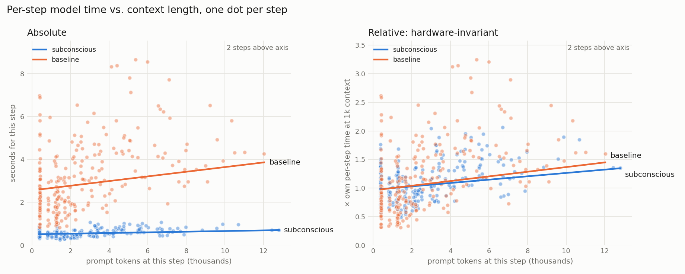

# hops

A question set for comparing two inference backends on multi-hop search, plus
the tool-calling loop (`agent.py`) that runs both arms identically.

## What is compared

Accuracy is reported to establish that both arms solve the same problems; the
comparison of interest is cost (steps, tokens, `model_seconds`) at matched
accuracy. If one arm failed many questions, its token counts would measure
abandonment rather than efficiency, so near-ceiling accuracy on both arms is
the precondition for the cost comparison, not a sign the set is too easy.

## Run protocol

- Both arms run the identical loop in `agent.py`: same system prompt, same tool
  schema, same `MAX_STEPS = 12`, temperature 0. `run.py` stamps every trace
  with `config`, a hash of those three, so a mismatch is visible after the fact.
- The baseline arm goes through OpenRouter pinned to a single provider with
  fallbacks disabled (`BASELINE_PROVIDER` in `.env`), and every step records
  which provider actually served it (`served_by`).
- Arms are interleaved per question, and the order alternates (A then B, then
  B then A), so time-of-day load affects both arms equally.
- 20 questions × 3 repeats × 2 arms = 120 runs, appended to
  `results/run_<timestamp>.jsonl` as they finish; rerunning with `--out` on
  the same file resumes.

## Results

Run `results/run_20261018_160923.jsonl`, reproduced by
`python analyze.py results/run_20261018_160923.jsonl` (needs numpy and
matplotlib). Arms: `subconscious/deepseek-v4.1-flash-marathon` vs
`deepseek/deepseek-v4.1-flash-20260910` on OpenRouter pinned to
`deepinfra/fp8`. All 120 traces share config `1a8c071e718cd635`, and all 247
baseline steps were served by DeepInfra.

| | Subconscious | Baseline |
|---|---|---|
| Pass (scored) | 58/60 | 55/60 |
| Pass (hand-checked) | 58/60 | 56/60 |
| Median steps | 3 | 3 |
| Median tokens | 5,942 | 6,417 |
| Median model seconds | 1.76 | 9.27 |
| P95 model seconds | 6.07 | 37.36 |
| Seconds per step (median) | 0.56 | 2.69 |
| Hard four (uni-5, muni-4, corp-4, paper-4), median tokens | 21,169 | 17,138 |

**Faster in every pair.** Subconscious had lower `model_seconds` in 60/60
(question, repeat) pairs: 4.5× at the median, 2.1× minimum, 14.8× maximum. The
gap is larger at P95 than at the median.

**Not fewer tokens.** About 6% fewer overall, but more on the hard four,
because it took more steps on 8 of 20 questions. Token counts here can't show
pruning in either direction: the loop resends the full conversation each step,
so billed tokens are whatever the client sends, which is the same for both arms
given the same conversation. Any pruning happens server-side, after the tokens
are counted. Token differences reflect behavior (number of steps) only.

**More consistent.** Median token spread across the three repeats of a question
was 126 for Subconscious vs 1,976 for the baseline; Subconscious used identical
token counts on all three repeats for 2 of 20 questions (e.g. infra-3: 3,071
every time), the baseline for none.

**Hand-check of non-passes.** Scores are left as the scorer produced them; the
alias lists were not changed.

| run | arm | verdict | answer | hand-check |
|---|---|---|---|---|
| uni-1 rep2 | baseline | REVIEW | "UC Berkeley (Cal)" | correct; the parenthetical defeats the string match |
| muni-4 rep3 | baseline | REVIEW | "North Andover" | wrong (gold Andover) |
| muni-2 rep3 | baseline | FAIL | "Waltham" | wrong (Waltham 1738; Belmont 1859) |
| corp-4 rep3 | Subconscious | FAIL | "Solexa" | wrong: the Illumina wrong turn seen in probing, not recovered this time |
| muni-4 rep2 | both | EMPTY | none | hit the 12-step cap |
| paper-1 rep2 | baseline | EMPTY | none | hit the 12-step cap |

### Is the speedup the runtime or the hardware?

From outside, the 5× latency gap can't be attributed to marathon's runtime
rather than faster or less loaded serving hardware, plus the OpenRouter
routing hop on the baseline. One measurement comes closest to separating them.

Each step is fit as `seconds = a + b·(prompt tokens/1k) + c·(output tokens/1k)`.
`b` is the cost of reading more context; `c` (output length) is included so
writing time doesn't leak into `b`. If pruning works, marathon's step time
should grow less as context grows. But faster hardware lowers the slope too,
since reading context is itself a hardware cost, so raw slopes can't separate
the two. The comparison is the **relative slope**: `b` divided by the arm's
own per-step time at 1k context. Uniform hardware speedup leaves it unchanged;
pruning would shrink it. 95% intervals resample whole runs, since steps within
a run aren't independent.

| | Subconscious | Baseline |
|---|---|---|
| Slope, seconds per 1k prompt tokens | 0.015 [0.008, 0.022] | 0.108 [−0.035, 0.285] |
| Per-step time at 1k context | 0.52 s | 2.66 s |
| **Relative slope, % per 1k prompt tokens** | **2.9 [1.6, 4.3]** | **4.1 [−1.3, 11.5]** |
| Seconds per 1k output tokens | 1.95 (~510 tok/s) | 8.88 (~113 tok/s) |

The raw slope is about 7× flatter for Subconscious, which faster hardware
alone would produce. The relative slopes overlap heavily, so there's no
detectable pruning effect. The output-speed ratio (8.88 / 1.95 = 4.6×) nearly
matches the median per-pair speedup (4.5×): the speedup tracks generation
speed, not context handling.

**Summary.** Marathon was about five times faster per step and more consistent
run to run, at the same accuracy. It didn't use fewer tokens. Within contexts
up to 13k tokens, its time per step grew with context at the same relative rate
as the baseline's, so this run can't attribute the speedup to its runtime rather
than its hardware.

**Limits of the slope analysis.**

- Not detecting a difference isn't evidence of no difference. The baseline's
  interval is too wide to rule out a moderate pruning effect.
- Contexts were short (max 12.8k prompt tokens), where writing dominates step
  time. Pruning would plausibly matter at 50k–200k.
- "Hardware-invariant" is approximate. It assumes faster serving speeds up
  reading and writing by the same factor; reading context and generating
  tokens load hardware differently, so a hardware or software change can speed
  one more than the other.
- Prefix caching on either side would make re-sent context nearly free and
  flatten both slopes regardless of pruning. Whether either arm caches wasn't
  checked.
- The intercept includes network time, which is higher on the baseline through
  OpenRouter (0.36 s vs 0.29 s) and slightly inflates its denominator.
- The fit is linear. Attention cost grows faster than linearly at long
  contexts, so it shouldn't be extended past the observed range.

## questions.jsonl

One row per question: `id`, `family`, `hops`, `question`, `gold`, `aliases`,
`source` (list of URLs, pinned to a page revision where possible), `notes`.

Rules each row is held to:

- The top two candidates are not close; `notes` records the margin.
- Attributes don't drift (founding years, land area, not enrollment or capacity).
- Attributes are reliable across sources. This is separate from margin: early
  colonial incorporation dates and corporate founding dates (predecessors,
  mergers, renamings) disagree between sources, so even a wide gap on such an
  attribute rests on which source was picked. Woburn 1642 vs Reading 1644 was
  rejected on both counts.
- Every row cites the page its gold was checked against.
- Each family has one hard question built as a chain of sequential
  dependencies, where each search can't be written until the previous returns.

## Design rule: hops come from what the model doesn't know

The number of steps a question takes is set by what the model can't recall, not
by how many hops the question asks for. A chain whose first link is famous
collapses: the model recalls it and skips toward the end (infra-2 finished in 2
steps; the Anderson Bridge chain in infra-3 resolved its first two links from
memory). A chain whose first link can't be recalled forces the sequence:
"Wood End" (muni-4), a 2026 index change (corp-4), a 2026 rename (corp-1).

The same effect shows up in milder form. In 5 of the first 15 probes (uni-1,
uni-3, muni-3, infra-1, infra-2) the model's first query already named the
whole candidate set. Those aren't broken questions, but a "find the set, then
compare" question whose set is recalled is a 3-step question in a 4-step
costume: only the attribute lookup is left. The `hops` field records the
design, and probe step counts record what actually happened.

Unrecallable isn't enough on its own; consecutive links must also live on
different pages. infra-5 starts from a September 2026 metro opening the model
can't know, but one search result stated both the new line and its terminus
station, so two links collapsed into one search and it finished in 3 steps.
The chains that held (uni-5, muni-4, corp-4) each require a comparison across
several pages between links, which no single page summarizes.

Practical check before writing a question: can the model name the first link
without searching? If yes, the chain needs a less recallable starting point.

## Step cap

`MAX_STEPS = 12` in `agent.py`, identical for both arms. A step is one model
round-trip. Raised from 8 after muni-4 hit 8 without answering; at 12 it
finished correctly in 10, so it measures the question rather than the cap.
Its query log shows 6 of those 10 steps went to resolving the first link
(the old name "Wood End"), so expect high variance across repeats on it.

**Step counts are not deterministic at temperature 0.** Re-probing with an
empty cache moved several questions by one step (uni-5 7→6, muni-4 10→9,
muni-2 3→4), because Tavily returned slightly different results and the
model's next query depended on them. That is a second source of
nondeterminism alongside the model itself; repeats capture both.

Each step record includes `tool_args`, the raw arguments of every tool call,
so dependent and independent queries can be told apart in the traces.

## Search cache

`search_cache.json` maps each query to its Tavily result. The full run starts
from whatever cache exists, both arms read and fill it as they go, and the
resulting file is committed alongside the results as a frozen artifact. The
whole benchmark is then replayable without a Tavily key.

Any query issued by both arms gets byte-identical results, so differences come
from the runtime, not from Tavily's index shifting mid-run.

**Interleaving means whichever arm runs second on a question often hits a warm
cache.** Its `tool_seconds`, and so its `total_seconds`, are lower for reasons
that have nothing to do with the model. Alternating the order spreads this
evenly between arms, but per-question it still makes `tool_seconds` and
`total_seconds` invalid for comparison. That is why results report
`model_seconds`, steps and tokens, never `total_seconds`. It matters most on
muni-4, where 6 of 10 probe steps went to one hard lookup: if the second arm's
searches for that link are cached, the arms differ in tool latency there, but
not in steps or tokens.

## Aliases are frozen

Alias lists are written when a row is created, before it is probed. They are
not edited after arm two runs. If a REVIEW verdict later justifies a new alias,
it is added, **both arms are rescored**, and the change is logged below.

Alias changes after freeze: none.

## Retired IDs

IDs are never reused once results exist.

| id | reason |
|---|---|
| sb-1 | Sports family dropped: sports coverage collapses chains into single articles. Probed at 2 steps. |
| sb-2 | Sports family dropped; also compared stadium capacities (drift) with a ~4% margin. |
| uni-4 | Probed at 3 steps / 12 parallel tool calls: wide, not hard. Replaced by uni-5. |
| infra-2 | Probed at 2 steps: the model named all three Boston Harbor tunnels and their lengths in its first query. |

## Rejected candidates

Questions considered and thrown out before they got an ID, grouped by the rule
they broke. These are the evidence that the remaining set was filtered, not
just collected.

**Margin too small** (top two close enough that the gold is arguable)

| family | candidate | top two |
|---|---|---|
| universities | ACC charter members still in the league, most recently founded | Clemson 1889 vs NC State 1887 |
| municipalities | Lexington's neighbors, largest land area | Lincoln 14.4 vs Bedford 13.7 sq mi |
| municipalities | Lexington's neighbors, smallest land area | Belmont 4.7 vs Arlington 5.0 sq mi |
| municipalities | Wilmington's neighbors, earliest incorporation | Woburn 1642 vs Reading 1644 (also unreliable, below) |
| companies | Sept 22 2025 S&P additions, most recent IPO | Robinhood Jul 2021 vs AppLovin Apr 2021 |
| companies | July 2025 S&P additions, most recently founded | Datadog 2010 vs The Trade Desk / Block 2009 |
| infrastructure | Boston–Cambridge Charles River bridges, longest | Harvard Bridge 659.9 vs Longfellow 650.7 m |
| infrastructure | Red Line terminals including Mattapan, earliest | Ashmont 1928 vs Mattapan 1929 (infra-1 is worded to exclude Mattapan) |
| infrastructure | bridge that previously held Gordie Howe's "longest cable-stayed span in North America" title | Ravenel 471 vs Port Mann 470 m, and Mexico's Baluarte (520 m) makes the set ambiguous |
| papers | ICML 2026 honorable mentions, most / fewest authors | ties: 8 vs 8, 3 vs 3 |

**Attribute unreliable across sources** (gap may be wide, but depends on which date you accept)

| family | candidate | problem |
|---|---|---|
| universities | private ACC members, most recently founded | Miami 1925, but Duke can be dated 1838 or 1924 (renaming) |
| municipalities | Wilmington's neighbors, earliest incorporation | early colonial incorporation dates disagree between sources |
| companies | Mar 23 2026 S&P additions, earliest founded | Coherent's 1971 is II-VI's; EchoStar and Vertiv dates are spin-offs |
| companies | Mar 23 2026 S&P removals, earliest founded | Lamb Weston 1950 as a brand, 2016 as a spin-off |
| companies | Sept 22 2025 S&P additions, founding year | Emcor 1994 emerged from JWP's bankruptcy |
| companies | Mar 24 2025 S&P additions, founding year | TKO and Expand Energy are recent merger entities |
| companies | several 2025-26 batches, IPO year | SPAC listings (Vertiv), spin-off listings, Flex's 1994 re-IPO |
| infrastructure | 2026 airport openings | inauguration and first commercial flight are months apart (Halwara: Feb 1 vs May 15) |
| infrastructure | anything keyed to Nanjing Line 6's exact day | sources give Sep 29 and Sep 30; Nanjing South station Jun 26 and Jun 28, 2011 |
| papers | first-author affiliation | joint appointments, preprint vs camera-ready changes, name variants |
| papers | CVPR 2026 award papers, author count | SAM 3D lists 23 on arXiv as a team paper; proceedings count may differ |
| papers | ICML 2026 position papers, arXiv date | the API returned v1 dates that contradict the ID's month |

**Set membership ambiguous** (whether the winner belongs in the set is arguable)

| family | candidate | problem |
|---|---|---|
| municipalities | Ipswich's neighbors, most water area | Gloucester borders only across Essex Bay; without it, Rowley 2.1 vs Essex 1.9 |
| municipalities | Plymouth's neighbors, most water area | Duxbury touches only at Saquish Neck; without it, Bourne 12.2 vs Wareham 10.5 |
| municipalities | Hingham's neighbors, most water area | Hull borders across Hingham Bay; Hull 24.1 vs Cohasset 21.6 |
| companies | Dec 22 2025 S&P additions, HQ outside the US | CRH lists dual headquarters, Dublin and New York |
| papers | ICLR 2026 outstanding papers (any attribute) | secondary sources disagree on whether there were two or three |

**Hop can be skipped** (the question leaks a later hop, or one page answers it)

| family | candidate | problem |
|---|---|---|
| municipalities | chain starting from "Taunton North Purchase" (Easton) | the old name gives away Taunton, a later hop |
| municipalities | muni-4 ending on "most recently incorporated neighbor of Wilmington" | North Reading is also Reading's answer, so skipping a hop still scores |
| municipalities | Plymouth's neighbor in a different county | Plymouth's own article states the Bourne county line |
| sports (whole family) | Super Bowl chains | coverage summarizes whole seasons into single articles |
| infrastructure | Toronto Line 5 vs Line 6, longer | the model knows the planned lengths; only the opening dates are post-cutoff |
| infrastructure | chain through the Detroit–Windsor crossings | Ambassador Bridge and the tunnel are recalled; only the first link is new |

**Unreachable by the benchmark's search tool.** Recent facts can be true and
still fail here: before committing a question whose gold depends on a 2025-26
fact, `web_search` was called directly to confirm Tavily surfaces it. paper-4's
last link passed only with natural phrasings, noted in its row.

## Probing

    python probe.py <family>

Reads that family from `questions.jsonl` and writes `probe_results_<family>.json`.
Keep questions that take 3+ steps with a correct answer.
